<p align="center">
  
</p>

<p align="center">
  <strong>把想法编译成产品，让重复劳动交给代码。</strong><br />
  <sub>Turning curiosity into things you can actually use.</sub>
</p>

<p align="center">
  <a href="https://github.com/xliang-L/harbor"><strong>Harbor ↗</strong></a>
  &nbsp; / &nbsp;
  <a href="https://minimatch.space"><strong>MiniMatch ↗</strong></a>
  &nbsp; / &nbsp;
  <a href="https://github.com/xliang-L?tab=repositories"><strong>Explore the lab ↗</strong></a>
</p>

---

### `01` &nbsp; whoami

你好，我是 **xliang**。在 **AI、自动化和产品**之间折腾，喜欢把「这能不能做」变成「打开就能用」。

给工作流接上智能，给代码加一点美感。对能解决真实问题的小工具，以及有点想象力的实验，保持好奇。

```ts
const xliang = {
  role: "AI product builder",
  focus: ["agents", "automation", "tools for real work"],
  playground: ["creative coding", "visual experiments"],
  instinct: "If I do it twice, I start thinking about a script.",
  loop: "stay curious → build → ship → learn",
};
```

### `02` &nbsp; things I build

| 项目 / Project | 在做什么 / The idea |
| :--- | :--- |
| **[Harbor](https://github.com/xliang-L/harbor)** | 本地优先的营销工作台，把资料、内容、人工审核与效果复盘串起来。<br /><sub>Local-first marketing operations · TypeScript</sub> |
| **[MiniMatch](https://minimatch.space)** | Mac mini 租赁信息站，让设备与需求更容易遇见。<br /><sub>A place to discover Mac mini rental listings.</sub> |
| **[ekf_slam](https://github.com/xliang-L/ekf_slam)** | Python 实验仓库，记录定位、建图与路径规划方向的探索。<br /><sub>Localization, mapping & route-planning experiments.</sub> |

### `03` &nbsp; tools on the bench

**Build** &nbsp; `TypeScript` · `JavaScript` · `Python` · `React` · `Node.js`<br />
**Explore** &nbsp; `AI agents` · `Workflow automation` · `Creative coding`<br />
**Run** &nbsp; `Git` · `Linux` · `macOS` · `SQLite`

### `04` &nbsp; operating principles

- **让好奇心驱动开工，让真实问题决定方向。** — Curiosity starts it. Usefulness steers it.
- **把机械重复留给脚本，把判断和想象力留给人。** — Automate the routine. Keep the human spark.
- **做出来，跑一遍，再打磨。** — Build it. Run it. Make it better.

---

<p align="center">
  <samp>Less friction. More making.</samp><br />
  <sub>如果你也在折腾 AI、小工具或有意思的产品，欢迎在公开项目里交流。</sub>
</p>

<!-- Original artwork and layout. Inspiration: https://github.com/beydemirfurkan/awesome-github-profile and https://github.com/DenverCoder1/readme-typing-svg. No third-party implementation code is included. -->
